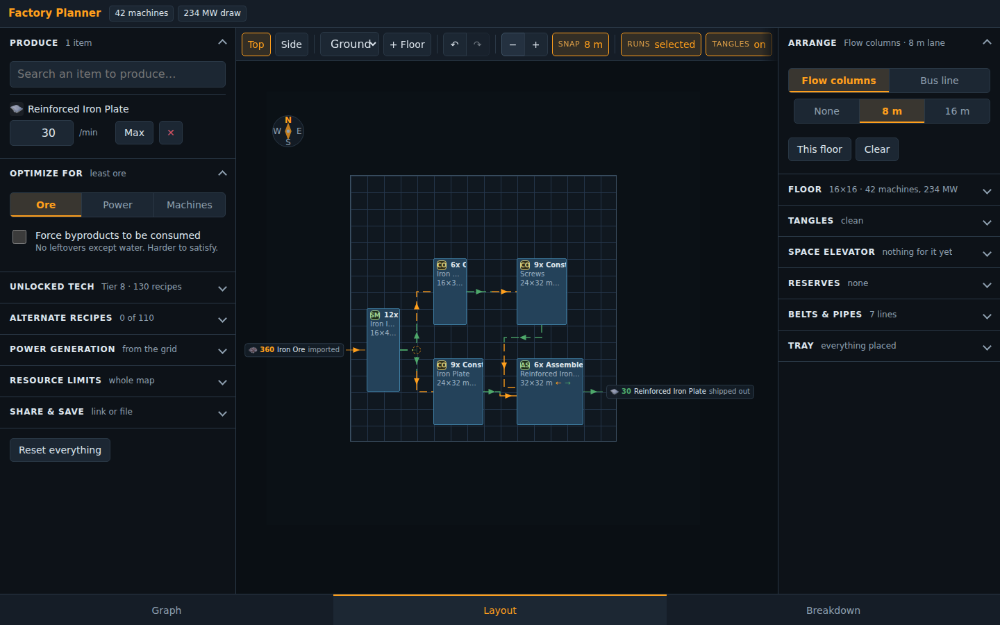
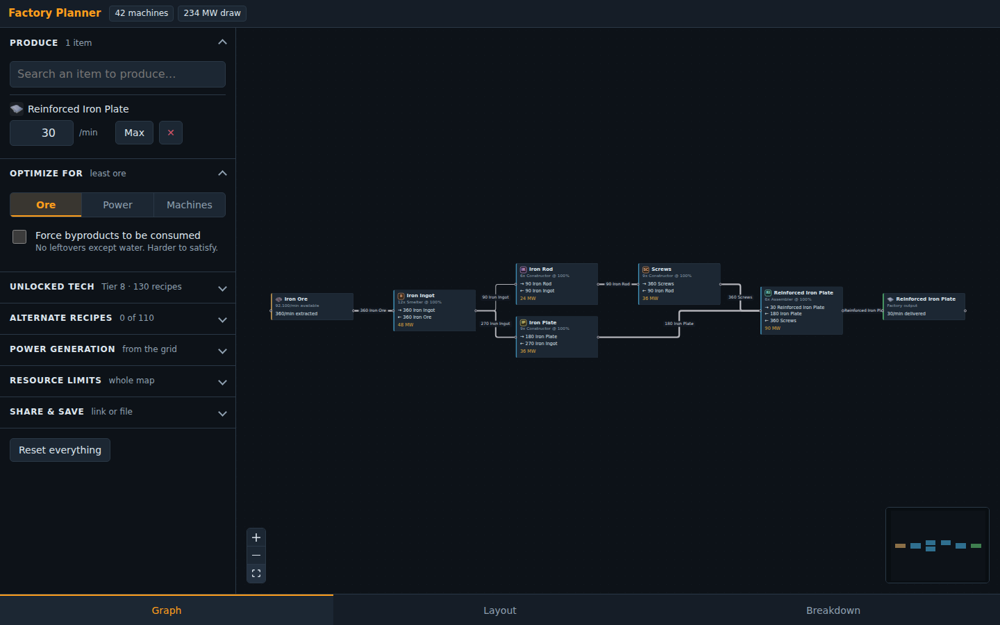

# Satisfactory Factory Planner

A browser based factory planner for Satisfactory. Say what you want to come out
and how fast, and it works out the machines, the power and the raw resources,
then arranges them across floors with belts, pipes and lifts. It runs entirely
in the browser: no account, no server, and the plan lives in the URL.



## What it does

**Setup.** Pick the items you want and the rate for each, set the tech tier,
switch alternate recipes on, cap individual resources, and choose what to
optimize for out of least ore, least power or fewest machines.

**Graph.** The production chain as a directed graph, raw resources through to
your targets, laid out automatically.



**Layout.** Machines as to scale blocks on an 8 m foundation grid, across
multiple floors, with belt and pipe runs drawn between them and an auto arrange
that packs a floor or a whole stack. Congestion analysis finds crossings, runs
sharing a lane, and belts passing over blocks, then ranks the moves that would
clear them.

**Breakdown.** Machine counts with the clock speed each group needs, power drawn
and generated, the raw resources with the nodes and miners behind them, any
surplus you have to deal with, and the minimum extraction a plan needs before it
is worth attempting.

## Try it

**[deetss.github.io/satisfactory-planner](https://deetss.github.io/satisfactory-planner/)**

The whole plan, layout included, rides in the URL fragment. Encoding happens as
you work, so the address bar is always a complete link with no button to press
first. Copy link in the Share & save panel compresses it to about half the
length, which is what makes a big plan sendable.

```
https://deetss.github.io/satisfactory-planner/#2.eyJ2IjoyLCJ0Ijp7Iklyb25QbGF0ZSI6MTIwfSwibyI6MCwiciI6OCwieiI6OCwiQSI6MCwiRiI6W1siR3JvdW5kIiwxMiwxMiwwLDAsMF1dLCJQIjpbXX0
```

Opening that gives you Iron Plate at 120 per minute: 12 machines, 48 MW draw.

## Development

Node and npm are the only prerequisites. The game data and the icons are
committed to the repo, so a fresh clone runs with no Satisfactory install
anywhere. You only need the game to refresh either of them, which is the next
section.

```bash
git clone "https://github.com/Deetss/satisfactory-planner.git"
cd "satisfactory-planner"
npm ci
npm run dev
```

`npm ci` rather than `npm install`, because the lockfile is committed and
`npm ci` installs exactly what it records. Reach for `npm install` only when you
are deliberately adding or bumping a dependency.

The rest of the scripts:

| Command | What it does |
|---|---|
| `npm run dev` | Vite dev server, printed address is usually `http://localhost:5173` |
| `npm run build` | Production build. It typechecks first: the script is `tsc --noEmit && vite build` |
| `npm run typecheck` | The typecheck on its own, without the build |
| `npm test` | The vitest suite, one run |
| `npm run test:watch` | The same suite, re-running as you edit |
| `npm run preview` | Serves the built `dist/`, for checking a production build |

Vitest reads the same `vite.config.ts` the app builds with, so module resolution
is identical in the tests and in the browser. There are five files in `test/`:
`solver` for machine counts, alternates, surplus rules and resource limits,
`layout` for belt and pipe choice, block packing, storage reserves and mining
node counts, `paths` for route shapes and congestion detection, `state` for plan
normalization and the v2 link codec, and `diagnose` for what the app reports
when a plan cannot be solved.

### Phone access

```bash
npm run dev -- --host
```

Then open the printed network address. On WSL2 with `networkingMode=mirrored`
the WSL IP is already the LAN IP, so no port forwarding is needed. Windows
Firewall may prompt for inbound on 5173 once.

## Where the game data comes from

Everything in `src/data/game-data.json` is derived from the game's own Docs
export by `scripts/extract-game-data.mjs`. The icons under `public/icons/` are
copied out of an FModel export by `scripts/import-icons.mjs`. Both are committed
to this repo, which is standard practice for community Satisfactory tools, and
it is what lets a clone build and run with no game install.

Refresh the dataset after a game update:

```bash
npm run extract
```

With no argument it checks three hardcoded WSL paths, which are the author's own
Steam and Epic install locations. Anywhere else, and that includes native
Windows, Linux and macOS, pass the path:

```bash
npm run extract -- "<Satisfactory>/CommunityResources/Docs/en-US.json"
```

Refresh the icons by pointing the importer at an FModel export folder:

```bash
npm run icons -- "./Exports"
```

It walks the export, takes only the icons the app references, downscales
anything over 64 px if `python3` has Pillow, and reports what it could not find.
Setting FModel up is the involved part: it needs a mappings file and a custom
versions file out of your game folder.
[docs/ICON-EXTRACTION.md](docs/ICON-EXTRACTION.md) covers that.

A few things about the extracted data are worth knowing:

- Fluid quantities, and the energy value of anything that is not a solid, are
  stored per cubic centimetre and scaled to cubic metres.
- Building footprints come from the clearance boxes, with rotation applied.
  Width and depth ignore boxes flagged `ExcludeForSnapping` or `CT_Soft`,
  because those volumes do not block placement. Height counts every box, since a
  machine's upper body is often a non-snapping one.
- Recipe names do not reliably track the buildable they produce, so unlock tiers
  are matched by product descriptor: a building's tier is the lowest one among
  the schematics that grant any build recipe for that descriptor.
- Node purity multipliers (impure 0.5, pure 2.0), the 250% overclock ceiling and
  the map-wide resource totals are not in the export. They are constants in the
  script, with their sources noted in comments.

## Known gaps

**The dataset shipped here predates the extractor's Space Elevator support.**
`src/data/game-data.json` carries no `spaceElevator` entry, so the Space Elevator
panel runs in a degraded mode. It still lists the elevator parts your plan makes
and how long 100 of each takes at that rate, but with no phase requirements to
read it cannot give per phase delivery times or size the depot. The panel says
as much on screen and points at the extractor. Re-extracting against a current
install fixes it.

**143 of the roughly 200 icons the app references are present.** The 57 missing
are the 33 machine, generator, miner, belt, pipe and container icons from the
`Buildable/Factory` folder, which is most of what the Layout view shows, plus 24
event and ammunition items. A tinted initial stands in for each one, so the app
is fully usable without them. `docs/ICON-EXTRACTION.md` lists the FModel folders
that cover the rest.
